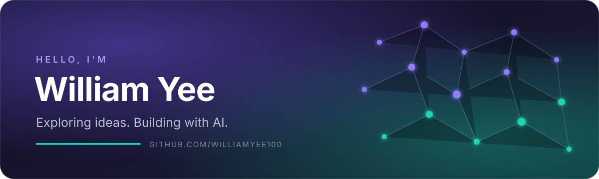

<div align="center">
  
</div>

<p align="center">
  <strong>AI Explorer · Builder · Lifelong Learner</strong><br/>
  Turning ideas into practical, human-centered AI experiences.
</p>

<p align="center">
  <a href="https://github.com/williamyee100?tab=followers">
    
  </a>
  
</p>

## 👋 About me

Hi, I'm **William** — an AI enthusiast learning in public and building useful things with modern AI tools.

- 🧠 Exploring **large language models, AI agents, RAG, and intelligent automation**
- 🛠️ Interested in turning AI capabilities into simple, practical products
- 🌱 Learning through experiments, open-source projects, and clear documentation
- 🤝 Open to collaborating on thoughtful AI projects

## 🔭 Current focus

```text
AI applications      ████████████████░░░░
Agent workflows      ██████████████░░░░░░
RAG & knowledge      ████████████░░░░░░░░
Automation           ███████████████░░░░░
```

## 🧰 AI toolkit

<p>
  
  
  
  
  
</p>

> This toolkit reflects what I'm exploring and learning. I'll keep updating it as I build and publish real projects.

## 🚀 What I'm building toward

- Helpful AI assistants that solve focused, real-world problems
- Reliable agent workflows with clear human control
- Search and knowledge tools powered by RAG
- Small automations that remove repetitive work

## 🧭 How I work

1. **Start with the problem** — technology should serve a real need.
2. **Build small, learn fast** — working prototypes beat endless planning.
3. **Keep humans in control** — useful AI should be transparent and responsible.
4. **Share the journey** — clear notes make every experiment more valuable.

## 📊 GitHub activity

<div align="center">
  
  
</div>

## 🤝 Connect

The best way to reach me for now is through GitHub. Feel free to follow my work or open a discussion on one of my future projects.

<p align="center">
  <a href="https://github.com/williamyee100">
    
  </a>
</p>

---

<p align="center"><sub>Learning openly. Building thoughtfully. Improving continuously.</sub></p>
